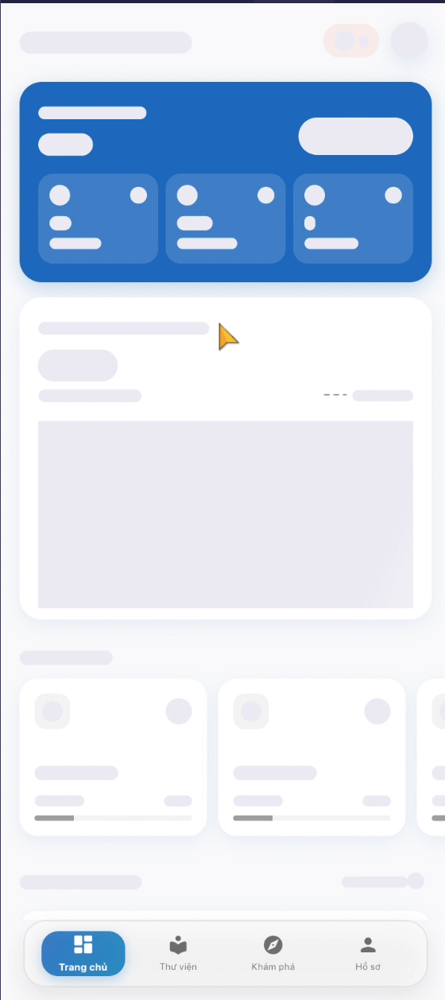
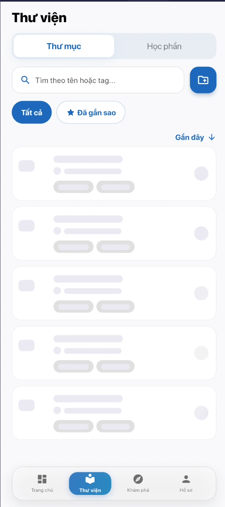

# 📚 Mind Deck

> 🚧 **Work in progress**: this project is under active development.

A flashcard app for learning and sharing knowledge. Create your own decks, study them, and explore decks shared by the community.

## ✨ Features

- 🔐 Authentication
- 🗂️ Create and study flashcard decks
- 🌍 Share decks with the community

## 🛠 Tech Stack

Flutter · BLoC · Dio · Node.js · PostgreSQL · Firebase

## 📱 Screenshots

  
  
  

